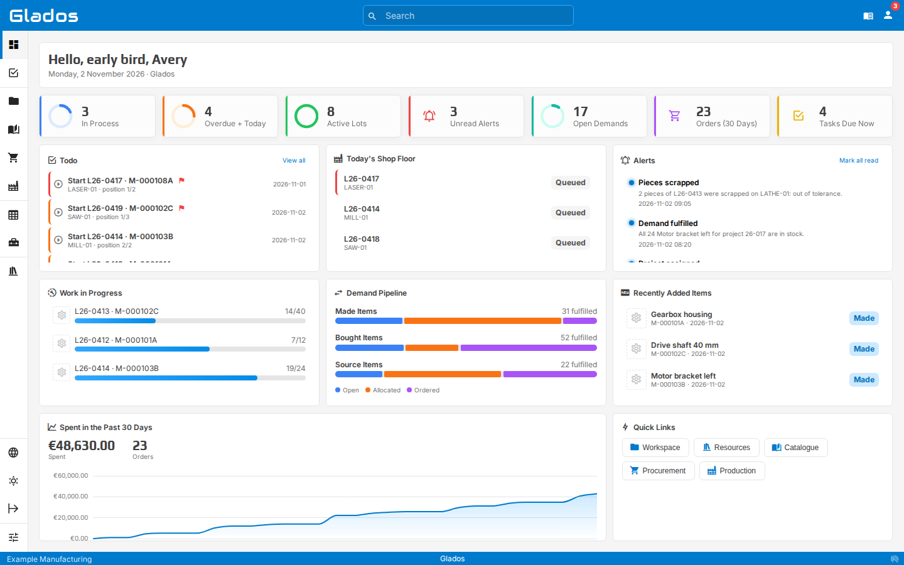
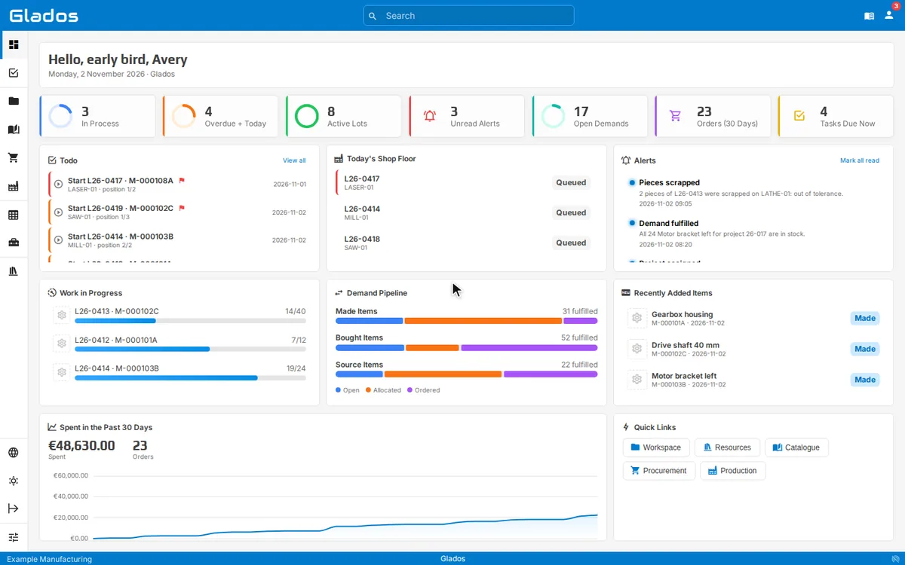
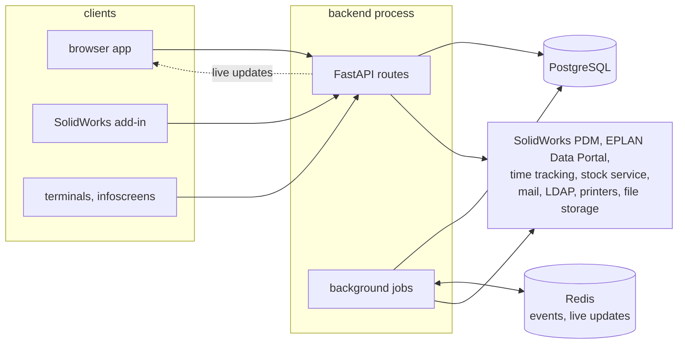
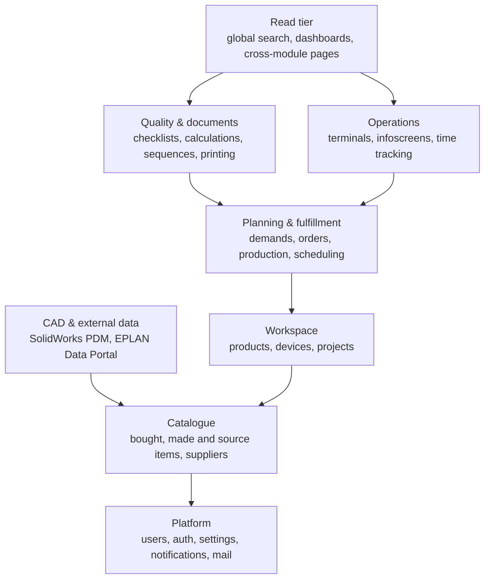

# GLADOS

GLADOS is a web app for planning a manufacturing shop's work. It manages your projects and the items they need, keeps purchasing in order, and plans production from the first lot to the final inspection.

<picture>
  <source media="(prefers-color-scheme: dark)" srcset="docs/assets/glados-dashboard-dark.png">
  
</picture>

> [!NOTE]
> GLADOS is written for the workflows of my company, so it works the way we work: parts are designed in SolidWorks PDM, material is bought and stocked, production runs in lots and every part is checked before it moves on. Some things may look unusual for a general tool, but they are intended. GLADOS is not meant to be a general purpose ERP or MES.

## What you can do with it

- **Keep a catalogue** of the parts you make, the parts you buy and the raw materials you cut them from.
- **Track demand** for every project and see at a glance which needs are already covered by stock, orders or production, and which are still open.
- **Plan production lots** from the first draft through scheduling, execution and completion, step by step and position by position.
- **Schedule the shop floor** with Auto-Plan, which queues production orders onto machines and machine pools for you.
- **Approve materials and run QA** before parts move on.
- **Print labels and dockets** straight to the shop's printers.



<sub>All names and numbers in these pictures are made up.</sub>

## Working with SolidWorks PDM

Engineers design parts in SolidWorks, and the PDM vault stays the source of truth for everything that comes from CAD. GLADOS picks up changes from the vault automatically and shows those fields as read-only in the web app, so nobody ends up editing the same data in two places.

The SolidWorks add-in that runs on the engineer's workstation lives in its own repository, [`glados-sw-addin`](https://github.com/deloarts/glados-sw-addin), and so does the PDM vault add-in, [`glados-pdm-addin`](https://github.com/deloarts/glados-pdm-addin). Both talk to this backend through its personal-access-token API.

## How it's built

This repository holds both halves of the app, and they are released together under a single version:

- `backend/` is a Python 3.13 FastAPI service backed by PostgreSQL and Redis.
- `frontend/` is a Vue 3 app built with OpenVue and Vite.

```
glados/
├── backend/        # FastAPI service, Alembic migrations, OpenAPI snapshots
├── frontend/       # Vue 3 web app
├── docs/           # development, contributing, ADRs, installation, operations, ...
├── scripts/        # release and deployment helpers
├── docker-compose.yml       # production stack, prebuilt images
├── docker-compose.dev.yml   # local development stack
└── CHANGELOG.md  CLAUDE.md  README.md
```

## Architecture

GLADOS is a modular monolith: one backend, one database, and the code is split into modules that only depend on each other in one direction.

All clients talk to the same backend:

- the browser app
- the SolidWorks add-in
- terminals and infoscreens on the shop floor, driven by [`glados-terminal`](https://github.com/deloarts/glados-terminal)

The backend stores its data in PostgreSQL and uses Redis for events and live updates. Background jobs (PDM sync, mails, backups, ...) run in the same process.



The backend is split into seven modules. Each module is a bounded context with its own hexagonal layers (domain, ports, application, adapters). The rules are simple:

- A module can only use the modules below it
- A module can only use the public API of another module
- Pages that need data from several modules live in the read tier on top
- The frontend features follow the same map

Guard tests and import-linter contracts check these rules, so a wrong import fails the tests.



For more details see:

- [CONTRIBUTING.md](docs/CONTRIBUTING.md#1-architecture-in-one-page): the full picture, including how a write travels from the browser to the live update
- [ADR 0012](docs/adr/0012-modular-monolith-bounded-contexts.md): why the code is split this way
- [module-boundaries.md](docs/reference/module-boundaries.md): the exact rules

## Installing

GLADOS runs on Docker Compose, either directly or under [Portainer](https://www.portainer.io/). Running it on bare metal without containers is not supported.

```bash
git clone https://github.com/deloarts/glados.git /opt/glados && cd /opt/glados
cp .env.example .env
nano .env
docker compose up -d
```

[docs/INSTALLATION.md](docs/INSTALLATION.md) walks you through the full setup, including SSL, configuration and upgrades.

## Developing

The easiest way to get going is the dev stack, run from the repository root:

```bash
cp .env.dev.example .env.dev
docker compose -f docker-compose.dev.yml --env-file .env.dev up -d --build
```

If you'd rather run each half on your own machine, the root `Makefile` wraps the usual commands (`make help` lists them; `make setup`, `make infra`, `make dev-backend`, `make dev-frontend`, `make test-fast`, `make gates`). By hand:

```bash
cd backend
poetry install
poetry run pytest tests/unit -q   # needs Redis on localhost:6379, uses db 15
```

The backend tests use a throwaway SQLite file, but they need a running Redis server (database 15, never the dev app's 0). The full suite is slow; see [DEVELOPMENT.md](docs/DEVELOPMENT.md#9-test-conventions) for running only part of it.

```bash
cd frontend
npm ci
npm run dev
```

[docs/DEVELOPMENT.md](docs/DEVELOPMENT.md) covers the rest: environment configuration, running only the infrastructure in Docker, service endpoints and database migrations.

## Documentation

- [DEVELOPMENT.md](docs/DEVELOPMENT.md): setting up a local development environment
- [CONTRIBUTING.md](docs/CONTRIBUTING.md): how the code is organised and recipes for common changes
- [adr/](docs/adr/README.md): the architecture decisions behind the code
- [INSTALLATION.md](docs/INSTALLATION.md): deploying GLADOS to a server
- [OPERATIONS.md](docs/OPERATIONS.md): day-to-day running, including storage, backups, restores and monitoring
- [INFRASTRUCTURE.md](docs/INFRASTRUCTURE.md): the corporate environment GLADOS lives in and how it shapes deployment
- [RELEASING.md](docs/RELEASING.md): versioning and how releases are cut
- [PDM_INTEGRATION.md](docs/PDM_INTEGRATION.md): the SolidWorks PDM integration from end to end
- [FIELD_OWNERSHIP.md](docs/FIELD_OWNERSHIP.md): which fields belong to PDM and which to GLADOS
- [TIME_TRACKING.md](docs/TIME_TRACKING.md): time tracking through the time tracking service from end to end, including its contract and security model
- [STOCK_SERVICE.md](docs/STOCK_SERVICE.md): the connection to the stock service and its contract
- [EPLAN_DATA_PORTAL_INTEGRATION.md](docs/EPLAN_DATA_PORTAL_INTEGRATION.md): the EPLAN Data Portal integration and the spreadsheet import settings
- [reference/](docs/reference/README.md): the full rules, checklists and edge cases behind each guide, for when a change has to be exactly right
- [CHANGELOG.md](CHANGELOG.md): what changed in each release

## License

GLADOS is source-available under the [DELOARTS License (DAL) 1.0.0](LICENSE.md). You may use, change and share it for noncommercial purposes: personal use, research and study, and use by charitable, educational, public research and government organizations. Any commercial use, including running it inside a business, needs a separate commercial license from license@deloarts.com.

Third-party components bundled with GLADOS remain under their own licenses.
