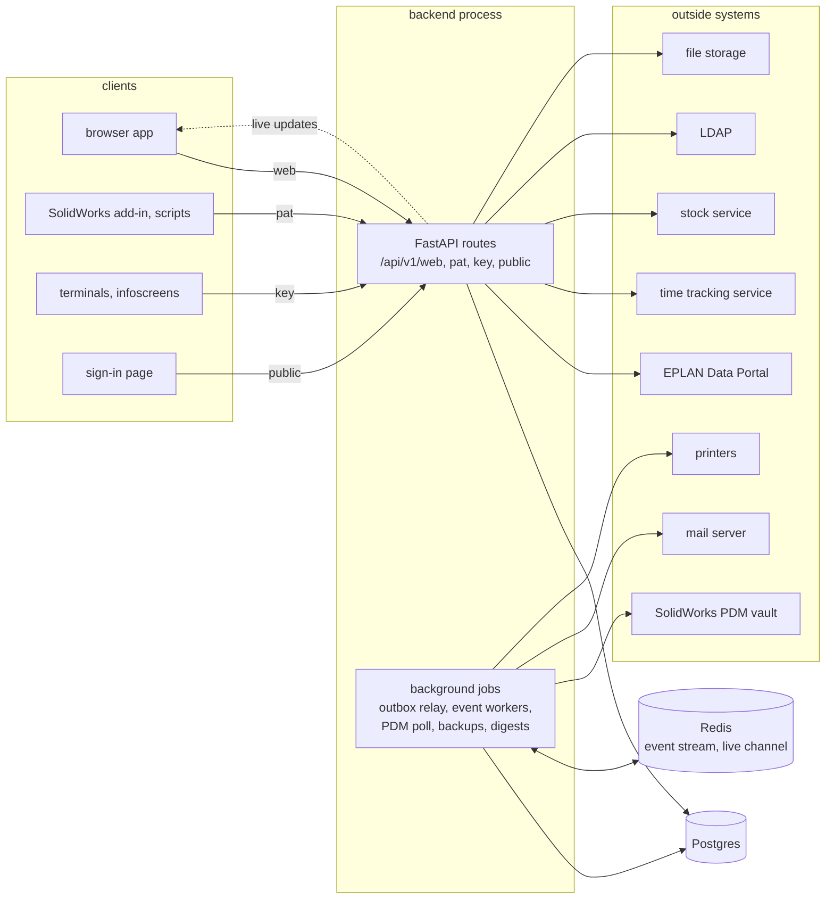
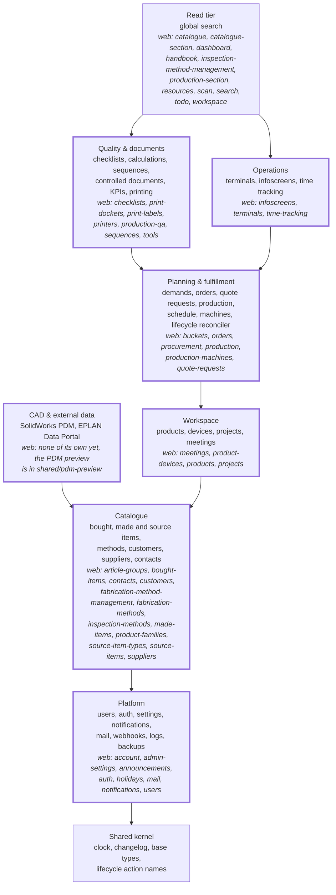
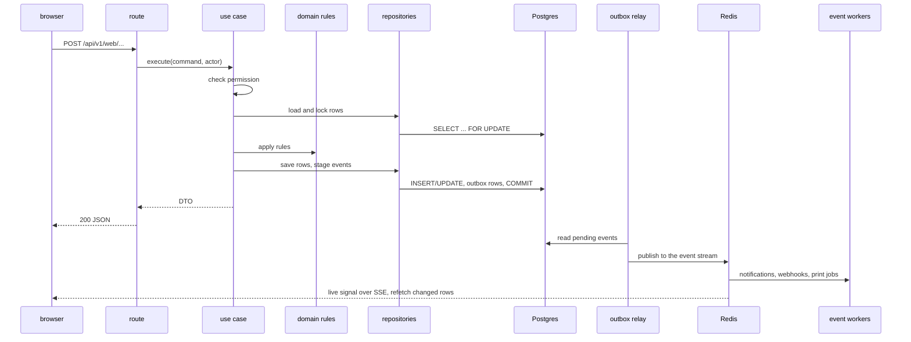

# contributing

How the code is organised and how to make the common changes. Read [DEVELOPMENT.md](DEVELOPMENT.md) first for the local setup, and [FIELD_OWNERSHIP.md](FIELD_OWNERSHIP.md) before touching item code. The reasons behind the big structural choices are recorded in [adr/](adr/README.md), and the domain vocabulary is in [section 10](#10-domain-glossary). This guide explains the ideas; the exact rules a change has to get right live in [reference/](reference/README.md), linked at the end of each section.

- [contributing](#contributing)
  - [1 architecture in one page](#1-architecture-in-one-page)
    - [1.1 backend layers](#11-backend-layers)
    - [1.2 where new backend code goes](#12-where-new-backend-code-goes)
    - [1.3 composition root and wiring](#13-composition-root-and-wiring)
    - [1.4 frontend layers](#14-frontend-layers)
    - [1.5 bounded contexts](#15-bounded-contexts)
  - [2 recipes](#2-recipes)
    - [2.1 add an endpoint](#21-add-an-endpoint)
    - [2.2 add a field](#22-add-a-field)
    - [2.3 add a domain error](#23-add-a-domain-error)
    - [2.4 add a frontend feature module](#24-add-a-frontend-feature-module)
    - [2.5 add an admin settings tab](#25-add-an-admin-settings-tab)
    - [2.6 add a PDF report](#26-add-a-pdf-report)
  - [3 backend conventions](#3-backend-conventions)
    - [3.1 use cases, auth and permissions](#31-use-cases-auth-and-permissions)
    - [3.2 DTOs and schemas](#32-dtos-and-schemas)
    - [3.3 logging](#33-logging)
    - [3.4 persistence](#34-persistence)
    - [3.5 soft delete](#35-soft-delete)
    - [3.6 events and the outbox](#36-events-and-the-outbox)
    - [3.7 lifecycle: facts, intents and the reconciler](#37-lifecycle-facts-intents-and-the-reconciler)
  - [4 frontend conventions](#4-frontend-conventions)
    - [4.1 the Glados look](#41-the-glados-look)
  - [5 i18n and German copy](#5-i18n-and-german-copy)
  - [6 handbook pages](#6-handbook-pages)
  - [7 testing](#7-testing)
  - [8 before you open a PR](#8-before-you-open-a-pr)
  - [9 comments, docstrings and language](#9-comments-docstrings-and-language)
  - [10 domain glossary](#10-domain-glossary)
  - [11 scheduling and Auto-Plan](#11-scheduling-and-auto-plan)

## 1 architecture in one page

Glados is one backend process behind four API audiences, with Postgres for data and Redis for events and live updates. The browser app uses `web`, the SolidWorks add-in and other scripts use `pat` (personal access tokens), terminals and infoscreens use `key` (device keys, [TERMINAL_INTEGRATION.md](TERMINAL_INTEGRATION.md)), and the sign-in page uses `public`. Every background job runs inside the same process ([1.3](#13-composition-root-and-wiring)).



Inside the backend the code is cut twice. The layers point inward ([1.1](#11-backend-layers)), and the bounded contexts point downward ([1.5](#15-bounded-contexts)): a context may use its own code, the shared kernel and the contexts it declares, never the ones above or beside it. The arrows show the direct dependencies that matter for reading the map; the exact declared list is in the guard test. The frontend features follow the same map ([1.4](#14-frontend-layers)); each box names them after `web:`. A box with a thick border marks a module no other module reaches past its public API: its privacy contract in `backend/.importlinter` ignores no import of another module.



One write travels like this. The route only translates HTTP; the use case checks the permission, applies the domain rules and stages its domain events in the outbox table in the same transaction as its rows ([3.6](#36-events-and-the-outbox)). After the commit the relay moves the events to the Redis stream, and the event workers send notifications, webhooks and print jobs. The changed rows are signalled on the live channel, so every open browser refetches them.



The lifecycles of lots, orders, demands, projects and the other aggregates are drawn in [LIFECYCLES.md](LIFECYCLES.md), generated from the code.

### 1.1 backend layers

The backend is hexagonal and fully async for I/O ([ADR 0001](adr/0001-hexagonal-architecture-async-io.md)). The code under `backend/src/` is cut into modules first ([1.5](#15-bounded-contexts)), one folder per module in `src/modules/<module>/`, and each module keeps the hexagonal layers inside. Next to the modules sit `src/shared_kernel/`, `src/read/` (the read tier) and `src/bootstrap/` (the composition root). Inside a module, dependencies point inward only:

```
adapters  ->  application  ->  ports  ->  domain
(infrastructure is cross-cutting and may be imported by adapters)
```

The domain holds plain dataclass entities and the business rules, in sync code that knows nothing of FastAPI, SQLAlchemy, Pydantic or Redis. The application layer holds one use case class per action together with its DTOs. The ports are Protocols for repositories and outside services, and the adapters implement them and expose the routes. A request goes from an async endpoint through a command DTO to `await UseCase.execute(actor, cmd)`, which applies the sync domain rules, awaits the repository ports and returns a result DTO that the route maps to its response schema. `poetry run lint-imports` enforces the layers in pre-commit and CI.

Full rules: [reference/module-boundaries.md](reference/module-boundaries.md#1-backend-layers).

### 1.2 where new backend code goes

Pick the module first ([1.5](#15-bounded-contexts)), then the layer inside it. A business rule goes into the domain, a persisted concept needs an entity, a repository port, an ORM model, a repository and a migration, and a new external system gets a port and an adapter that the composition root wires.

Full rules: [reference/module-boundaries.md](reference/module-boundaries.md#2-where-new-backend-code-goes).

### 1.3 composition root and wiring

`backend/src/bootstrap/main.py` is the only composition root. Its lifespan runs the migrations and starts every background job, such as the schedulers, the event workers and the outbox relay, as asyncio tasks on the worker process's event loop. Request-level dependency injection builds one use case per request from the factories in each module's `adapters/inbound/api/deps/` package, and endpoints receive their use cases through `Depends()`. A module never imports the composition root: where a factory needs an implementation from a module above, the module declares a binding and the root binds it at startup.

Full rules: [reference/module-boundaries.md](reference/module-boundaries.md#3-composition-root-and-wiring).

### 1.4 frontend layers

`frontend/src/` is layered `core`, then `shared`, then `features`. `core/` is platform code such as the API client, the generated types, auth, i18n and the realtime client; `shared/` is cross-feature UI and logic; each folder in `features/` is one domain module. A feature imports another only through that feature's `index.ts` barrel, and only within its own context or a context it declares, following the backend map. Lint and two specs guard the walls and the cycles. Help and printing reach features through providers that `main.ts` installs, and higher features register their parts with the Platform pages that host them, such as admin settings tabs and account sections, so no lower page imports a higher feature.

Full rules: [reference/module-boundaries.md](reference/module-boundaries.md#5-frontend-layers).

### 1.5 bounded contexts

The backend is cut into seven modules ([ADR 0012](adr/0012-modular-monolith-bounded-contexts.md)) under `backend/src/modules/`, read from the bottom: `platform`, `catalogue`, then `workspace` and `external_data` (CAD & external data), then `fulfillment` (Planning & fulfillment), then the siblings `quality` (Quality & documents) and `operations`. Each module declares the modules it may import in `DEPENDS_ON` (`backend/tests/unit/test_context_boundaries.py`). The shared kernel sits below them all, and the read tier and the composition root sit above them.

A module reaches another module only through its public API: its `api.py` and its named interfaces, such as its entities, events, DTOs and the ports it publishes. Everything else is internal, and other modules change a module's data only through its use cases. To reach a higher module, a lower one owns a port that the higher one implements, or publishes a domain event. Platform never names a module: each module registers its events, live topics and notification rules in `src/bootstrap/registrations.py`, and extends the settings with its own sections. `poetry run lint-imports` checks all of it against `backend/.importlinter`.

Full rules: [reference/module-boundaries.md](reference/module-boundaries.md#4-backend-modules).

## 2 recipes

Each recipe here is the short version. Agents and anyone making the change work through the full list in [reference/recipes.md](reference/recipes.md).

### 2.1 add an endpoint

In the module the operation belongs to, write the request and response schemas, the command and result DTOs, a use case that checks the permission first and lets the domain decide, the mapper, a deps factory and a thin endpoint. Then re-export the OpenAPI snapshots and regenerate the frontend types; the `export-openapi` pre-commit hook does both, and CI fails on drift. The `pat` snapshot is frozen once a release of its minor exists ([reference/releasing-ci.md section 2](reference/releasing-ci.md#2-the-pat-snapshot-check)).

Full rules: [reference/recipes.md](reference/recipes.md#1-add-an-endpoint).

### 2.2 add a field

A new field touches every layer of its module, from the entity, model and migration through the repository, DTOs, schemas and use cases to the frontend types, forms and i18n keys, and it needs tests. Item fields may be owned by PDM ([FIELD_OWNERSHIP.md](FIELD_OWNERSHIP.md)). The request schema, command DTO and response schema stay three separately written classes on purpose, so a field added to one never silently widens the frozen `pat` contract.

Full rules: [reference/recipes.md](reference/recipes.md#2-add-a-field).

### 2.3 add a domain error

Define the class in `domain/errors.py` of the module that raises it and inherit the semantic base from Platform's `domain/exceptions.py` that says what went wrong; the exception handler maps each base to its HTTP status, so a new error rarely needs an entry of its own. The handler answers with `detail` and a `code`, and clients match on `code`, so let the error propagate rather than raising `HTTPException`.

Full rules: [reference/recipes.md](reference/recipes.md#3-add-a-domain-error).

### 2.4 add a frontend feature module

Create the feature folder with the standard subfolders, add a barrel only when another feature needs it, place the feature in its context in the contexts spec, and register a lazy-loaded route.

Full rules: [reference/recipes.md](reference/recipes.md#4-add-a-frontend-feature-module).

### 2.5 add an admin settings tab

A tab is an `AdminSettingsTab<Name>.vue` component. A Platform tab is listed in `AdminSettingsView.vue`, and a tab that belongs to a higher feature lives in that feature and is registered by its plugin. Read two or three siblings first and copy their structure instead of inventing a new layout.

Full rules: [reference/recipes.md](reference/recipes.md#5-add-an-admin-settings-tab).

### 2.6 add a PDF report

Reports are PDFs rendered in the browser by `frontend/src/shared/reports/` ([ADR 0007](adr/0007-pdf-reports-in-the-browser.md)), which owns the page frame, palette, fonts, PDF/A output and the export dialog. A feature only describes its report as a `ReportSpec` built from the module's blocks and named styles, opens it from its Print button, and registers it as printable when prints should be journaled. There is no browser print.

Full rules: [reference/recipes.md](reference/recipes.md#6-add-a-pdf-report).

## 3 backend conventions

The async rules are in [reference/development-async.md](reference/development-async.md) and the datetime rule (UTC, timezone-aware, always) in [section 8](reference/development-datetime.md).

Full rules: [reference/backend-conventions.md](reference/backend-conventions.md#1-general-rules).

### 3.1 use cases, auth and permissions

A use case is one class per action, built fresh per request, and checks the actor's permission before anything else. Permissions are flat strings that a user holds directly or through their groups, with no denials, and `write:settings` is the de facto admin gate. One auth dependency resolves sessions, PATs and API keys and enforces maintenance mode. A PAT never holds more than its owner holds at the time it is used. A route whose repetition would book something twice, such as a delivery or a completion, accepts an `Idempotency-Key` so a client that lost the answer can safely send it again.

Full rules: [reference/backend-conventions.md](reference/backend-conventions.md#2-use-cases-auth-and-permissions).

### 3.2 DTOs and schemas

DTOs are the application contract and schemas the wire contract, kept separate even when they look alike. Response schemas list every field as required, and a closed vocabulary is typed as an enum or `Literal` so the frontend gets a union. Quantities in requests use the shared quantity fields, and whether a quantity must be whole depends on its unit. A supplier delivery may differ from the ordered quantity within the line's delivery tolerance.

Full rules: [reference/backend-conventions.md](reference/backend-conventions.md#4-dtos-and-schemas).

### 3.3 logging

Use the single global logger from Platform's `infrastructure.logging`. Request id and user are stamped onto every record for you.

Full rules: [reference/backend-conventions.md](reference/backend-conventions.md#7-logging).

### 3.4 persistence

Models are SQLAlchemy 2.0 declarative, one file per aggregate, with an int `id` for the app's own URLs and a `public_id` for links that leave the app and must keep working. Repositories return entities, never ORM rows, load relationships explicitly because every relationship raises on lazy load, and never commit: the use case owns a unit of work and commits once. Calendar days are read in the tenant's one timezone, quantities and changelogs have their own column types, and lifecycle statuses are written only by the reconciler ([3.7](#37-lifecycle-facts-intents-and-the-reconciler)). `test_no_repository_commits` guards the commit rule.

Full rules: [reference/persistence.md](reference/persistence.md#1-models-and-repositories).

### 3.5 soft delete

User-managed master data is archived and restored, never deleted, and uniqueness covers live rows only. Projects and meetings are the exceptions with a `deleted` column.

Full rules: [reference/persistence.md](reference/persistence.md#2-soft-delete).

### 3.6 events and the outbox

Publish a domain event when another component must react and that reaction must not block or fail the request; call the code directly when it must succeed or fail with the write. Events go through the transactional outbox ([ADR 0002](adr/0002-transactional-outbox-redis-streams.md)): the bus stages a row in the open transaction, so a use case publishes before `uow.commit()`, and the relay moves committed rows to the Redis stream. A separate live channel tells open browsers which rows changed. An architecture test and a runtime tripwire catch an event published after the commit.

Full rules: [reference/persistence.md](reference/persistence.md#3-events-and-the-outbox).

### 3.7 lifecycle: facts, intents and the reconciler

The status of a lot, lot position, production order, order, order line, demand and quote request is derived, never set ([ADR 0008](adr/0008-derived-lifecycle-statuses.md)). A fact is what was recorded, such as quantities, deliveries, completions and allocations. An intent is a timestamp that only a user action sets and only its inverse clears, such as `held_at` or `canceled_at`. Each aggregate has a decision table in `src/modules/fulfillment/domain/services/lifecycle/`, drawn in [LIFECYCLES.md](LIFECYCLES.md), and its status is the first row that matches.

A use case that changes facts or intents takes the request's lifecycle reconciler, touches every aggregate it writes, locks the touched rows and their dependents in the one lock order before it reads, checks the action against the aggregate's intent table, writes facts and intents, and runs the reconciler before it commits. The reconciler writes the derived fields that differ and publishes the status events. A user action is added as a rule in an intent table, never as a status transition. Orders, order lines, lots, production orders and projects carry an `edit_version` the client sends back, so a stale edit answers 409 (master data such as items, products, devices, suppliers and customers carry one too, moved on every change of the row), and a request that lost a database race before committing anything is retried once on the server. Every integration test ends with a drift check that compares stored statuses with their derivation.

Full rules: [reference/lifecycle.md](reference/lifecycle.md).

## 4 frontend conventions

Components use `<script setup lang="ts">` with strict TypeScript, single quotes and no semicolons, and there is no formatter to run. Styling is scoped SCSS on OpenVue's CSS variables, which also handle dark mode, so no utility CSS and no dark-mode media queries. Every promise is awaited, returned or handled. HTTP goes through the one axios instance, new calls through the typed `webApi`, and request and response types alias the generated `webSchema.ts`; lint flags hand-written wire types and raw calls. Tables and views follow other users' changes through `core/realtime/`.

Full rules: [reference/frontend-conventions.md](reference/frontend-conventions.md).

### 4.1 the Glados look

Every page looks and behaves the same way, so a user who knows one page knows them all. A page is a `PageLayout` with an info bar that names the record, a controls bar that holds every action of the page and, for lists, a views bar for filtering, grouping and sorting. Tabs sit above these bars and are part of the URL. A button the user lacks the rights for stays visible and disabled with the reason in its tooltip, and is hidden only when the record's state rules the action out. Tables, cards, dialogs, settings tabs and feedback each keep one shape. A deviation needs a reason and, if it is the better way, a change to the rules first.

On a phone Glados offers a smaller app under the same URLs: each route declares whether it, or which of its tabs, is built for a phone, and a page that is not shows a notice that still lets the user open it in full. Navigation moves to a bottom bar and dialogs take the whole screen.

Full rules: [reference/design-look.md](reference/design-look.md).

## 5 i18n and German copy

Every user-visible string goes through `t()`. Messages live in one file per namespace and locale under `src/core/i18n/locales/`, English being the source and fallback, and `npm run check:i18n` checks that both locales stay in step. German copy addresses the user informally, and the same check fails on the formal pronouns. German appears only in locale files, mail templates and handbook pages; everything else is English.

Full rules: [reference/frontend-conventions.md](reference/frontend-conventions.md#6-i18n).

## 6 handbook pages

The in-app handbook is markdown under `frontend/src/features/handbook/content/<locale>/<section>/<page>.md`, in English and German with the same headings, opened from a question-mark button next to the element or in the dialog header it explains. A page is written for an office user who knows the workshop, not the code, with worked examples checked against the validation in the code.

Full rules: [reference/handbook-pages.md](reference/handbook-pages.md).

## 7 testing

Backend tests need neither Redis nor Postgres: they run on a throwaway SQLite file with the Redis-backed ports faked, apart from opt-in race tests on a throwaway Postgres ([reference/development-testing.md](reference/development-testing.md)). Unit tests use fakes, integration tests call the API through authenticated client fixtures, and log assertions use `glados_caplog`. The lifecycle rules also have a property suite. Frontend specs are Vitest with jsdom next to the code, mounted with `mountWithApp()`, built from shared factories and selecting by role, label or test id. If an existing test looks wrong after your change, raise it in review instead of quietly adjusting it.

Full rules: [reference/testing.md](reference/testing.md).

## 8 before you open a PR

`make gates` (repo root) runs the lint, format, type and contract checks of both halves; `make test-fast` runs the quick test loop. By hand, backend from `backend/`:

```bash
poetry run ruff check src tests scripts alembic
poetry run ruff format --check src tests scripts alembic
poetry run mypy src scripts
poetry run lint-imports
poetry run pytest tests/path/to/test_changed.py -q
poetry run python scripts/check_openapi.py   # when a route or schema changed
```

Frontend, from `frontend/`:

```bash
npm run ci   # type-check, lint:check, test:unit:run, check:i18n, check:api-types
```

Frontend `.vue` and `.ts` files over 600 lines of code fail lint, except the older files in a shrink-only baseline that caps each at its size ([frontend-conventions.md section 1](reference/frontend-conventions.md#1-code-style)). On the backend, `make size-report` (a non-blocking CI step running `backend/scripts/check_function_length.py`) lists functions over 100 lines. New code should not add to either, so split the file or function, or exempt a generated or intentionally long file with a reason in `eslint.config.ts` or the script.

CI runs the full backend suite on every pull request, in four parallel shards, and checks coverage on the combined result. Keep a PR reviewable in one sitting; split large refactors per aggregate or feature. Branching, squash merges and releases are in [RELEASING.md](RELEASING.md).

## 9 comments, docstrings and language

- Every Python module starts with a docstring stating its purpose and the decisions behind it, without repeating the module's own path. An empty `__init__.py` package marker needs no docstring. Inline comments are rare and explain non-obvious business or security logic.
- Comments and docstrings say what the code does and why, in normal sentences, then stop. No padding, no restating the signature, no history ("was removed in ..."), no references to planning notes or ticket labels. `scripts/check_plan_refs.py` enforces the last point in pre-commit and CI; a genuine use (a domain term that looks like a label) goes into `scripts/plan_refs_allowlist.txt`.
- The repository language is English everywhere except locale files, mail templates and handbook pages.
- Documentation has two tiers. A guide in `docs/` explains what a part of Glados is, how it fits together and why, and links to its reference file in `docs/reference/`, which states every rule, checklist and edge case a change has to get right. Each fact lives in one of the two, never both; the contract is in [reference/README.md](reference/README.md).
- Markdown files put each paragraph and each list item on a single line and never break a line mid-sentence, so they read well on narrow screens. Code blocks and tables keep their own layout.

## 10 domain glossary

The rule-like detail behind these terms is in [reference/domain-rules.md](reference/domain-rules.md).

- **Made, bought and source items.** Bought items are purchased and project-agnostic. Made items are manufactured, with part number, revision, material and routing, and status `ACTIVE`, `INACTIVE` or `REPLACED`; a new revision is a copy, never an edit in place. Source items are raw-material specs and stand alone.
- **PDM field ownership.** The SolidWorks PDM vault owns CAD-authored fields, and part numbers are unique across the app. See [FIELD_OWNERSHIP.md](FIELD_OWNERSHIP.md) and [PDM_INTEGRATION.md](PDM_INTEGRATION.md) (settings, poller, trigger endpoint, ingest, snapshots and parked conflicts).
- **Demands, buckets and allocations.** Demands describe material needs for made, bought and source items; allocations cover them from stock, orders or production, substitutions included. Buckets are named, coloured groups per demand kind. A demand's status is derived from its allocations and its two intents, canceled and fulfilled, which are the only statuses a user sets. A demand can be covered by a different item of its family when the allocation declares the substitution. The use cases are written once for every demand family, and each family supplies only what differs.
- **Lots, positions, steps and production orders.** A production lot batch-produces a made item for a project. It owns ordered lot steps grouped into lot positions. A position's kind (`UNASSIGNED`, `INTERNAL`, `EXTERNAL`, `MIXED`) and its completed count follow from its order lines and production orders. Lot status runs `DRAFT`, `PARTIALLY_PLANNED`, `PLANNED`, `IN_PROGRESS`, then `COMPLETED`, `CANCELED` or `SCRAPPED`, and `ON_HOLD` is an overlay over the active statuses. Production orders queue internal work against one position and run `QUEUED`, `IN_PROGRESS`, `PAUSED`, then `COMPLETED` or `CANCELED`.
- **Supplier orders and order lines.** An order groups lines for one supplier; most lines are bought, source or made, a made line being a lot position worked by the supplier. A line runs `PENDING`, `REQUESTED`, `ORDERED`, `PARTIALLY_DELIVERED`, `DELIVERED` or `CANCELED`, and an order with some lines ordered and others not yet is `PARTIALLY_ORDERED`. In code an order line is an `OrderItem` (`order_item_table`, `OrderItemStatus`), and its deliveries are `OrderItemDelivery` rows. An order may carry extra costs such as shipping or a discount beside its lines.
- **Quote requests (RFQ).** A quote request asks several suppliers for an offer on the same lines before anything is ordered. Each supplier row records the offer, and the award creates order lines for the winning suppliers in one transaction. Its status is derived like the other lifecycle statuses, and an award is voided when the order line it created is canceled.
- **Auto-Plan and pools.** Auto-Plan is the scheduling run that assigns orders to machines or machine pools in a queue sequence. Algorithms are selectable and only one run happens at a time (Redis mutex). Pool-first planning assigns a pool first and a concrete machine later.
- **Machine calendars and downtime.** A machine's working time per weekday comes from its own working hours or the production default. Calendar exceptions replace single dates, tenant holidays close every machine, and a downtime is a window in which the machine is down, which the scheduler cuts out of the working time ([section 11](#11-scheduling-and-auto-plan)).
- **Manufacturing assessment.** At a production order's final completion the operator records one `ManufacturingAssessment` for it: the actual minutes per piece, optionally the actual setup minutes, a complexity class and a note. It is asked rather than derived from the start and end times, which include pauses and setup, and collects data for estimating times later.
- **Source approval.** A lot sourced from a source item may need approval (`not_required`, `pending`, `approved`, `rejected`); approving creates the material assignment demand. Approve, reject and switch are lot intents. A lot whose first position a supplier does brings no material of ours, so it has no demand and nothing to approve (`awaiting_first_step`, `supplier_sourced`).
- **Master data and users.** Project, Product, Customer, Supplier, ArticleGroup. A project's status has nothing to derive it from, so a user moves it through its intents, and a held project refuses new work. Users have roles and permissions, LDAP or local auth, TOTP, passkeys and server-side sessions. Printer, PrintJob and PrintTemplate drive ZPL and IPP label and docket printing.
- **User groups.** A group is a named bundle of permissions with members, managed under Admin settings, Groups. Every member holds the group's permissions on top of their direct grants, and membership is kept in Glados, never synced from the directory.
- **Controlled documents.** Calculations, checklists and flow sequences are revisions of a lineage with one latest revision. A draft is edited under an edit lock, a release never changes again, and a correction is a new revision ([ADR 0009](adr/0009-controlled-documents-and-export-journal.md)). Every download and print of a saved record's report is written to the export journal and shown as the record's distribution.
- **Product families.** The manufacturer's product family of a bought item, such as cylinders or valves, a managed list next to the article groups. An item has at most one, while it may have several article groups, which are Glados' own purchasing classification. Ingest never writes it, so it stays editable on a CAD row.
- **Product devices.** The cylinders, motors, grippers and other actuated units of a product (machine), each in reality a group of parts such as a cylinder with its valve and two sensors. A device's name is built from a location, a name, the letter of its driving medium and a counting number, and is unique per product, archived devices included. A device has a kind whose positions (retracted, extended, ...) give its initial position and the end position a sensor confirms. Its parts are components with signals and reliability data.
- **Driven and operator devices.** A device may be driven by another device of its product, such as a second clamp cylinder on the first one's valve; sequences move the driver. Buttons, key switches, indicator lamps and E-stops are devices of kinds without driving medium.
- **PLC environments and tags.** A PLC environment (a device resource, such as Siemens TIA Portal) holds the prefixes, conversion and export columns from which each signal's PLC tag is built out of the device's name. A product's tag list adds manual tags and exports an Excel sheet in the environment's columns.
- **Device completeness and disciplines.** A product says whether it has pneumatics, hydraulics, electrics and robotics. They pick the plans a device has to be ticked as drawn in (the CAD assembly always, EPLAN, the pneumatics and hydraulics plans, the robot program) and the plans a device rename names in its warning; a rename takes the device's ticks away. The completeness matrix also shows whether a released or only a draft flow sequence moves or checks each device.
- **Product variants.** The formats a product (machine) produces, such as part sizes, kept as one ordered list per product. A variant taken out of the list is archived, never deleted, because flow sequences refer to it by id.
- **Flow sequences.** A product's sequences (automatic cycle, homing, manual mode) as controlled documents, shaped after GRAFCET (IEC 60848) and the sequential function charts of IEC 61131-3. A sequence is an ordered list of steps whose actions move devices to positions, joined by transitions with conditions. The page shows the steps, the displacement-step diagram and the GRAFCET chart.
- **Estimated cycle time.** Rough planning data, not a part of the control, added up from the devices' travel times and the steps' expected durations along the branches the engineer picks.
- **Engineering tools.** The `/tools` page (`features/tools/`) holds calculators whose results can be saved as calculations, a controlled document kind: drive sizing (a servo drive on a linear axis over a motion profile) and safety distance (protective device separation after ISO 13855, reach distances after ISO 13857, two-hand controls after ISO 13851 and gaps against crushing after ISO 13854). The fit calculator there and the reference tables under `/tables` (general tolerances, threads) are looked up, not saved. A calculation may refer to one device of its product.
- **Time tracking.** Glados shows a signed-in user their own attendance data from an external attendance system on the Time Tracking page, with credentials each user stores for themselves, sealed so only the time tracking service can open them. Glados talks only to that service, a separate container in the stack, over a contract Glados defines; see [TIME_TRACKING.md](TIME_TRACKING.md).
- **Stock service.** Glados will read from a stock system through a stock service, a separate container in the stack, over a contract Glados defines. So far only the connection is set up: the admin settings, a connection test and the Host tab card; see [STOCK_SERVICE.md](STOCK_SERVICE.md).
- **EPLAN Data Portal and data import settings.** The EPLAN Data Portal is EPLAN's public catalogue of manufacturer parts. Glados reads from it to create bought items and to look up or link existing ones, and never writes to it. The data import settings hold one profile per spreadsheet import (bought item create, bought item demands, made item demands): the header row, where the data starts, the row limit and the column names per field. See [EPLAN_DATA_PORTAL_INTEGRATION.md](EPLAN_DATA_PORTAL_INTEGRATION.md).
- **Terminal.** One physical wall display, a TV on a Raspberry Pi running glados-terminal, identified by the Ed25519 public key of its bridge. Once approved it shows at most one infoscreen. See [TERMINAL_INTEGRATION.md](TERMINAL_INTEGRATION.md).
- **Infoscreen.** A screen definition built on the Resources tab: colour mode, theme, rotation, banner switch and pages of widget slots (machine board, lots due, late lots, QA queue, expected deliveries, message, clock). It can be shown on many terminals, and its feed carries no person names. Its language and display schedule apply to every terminal showing it. See [TERMINAL_INTEGRATION.md](TERMINAL_INTEGRATION.md).
- **Display schedule and override.** The weekday on-windows of an infoscreen, in the tenant timezone, with an optional holiday rule, which decide whether a terminal's display is on. A terminal's override forces it on or off until a given moment. The device state carries the result.
- **Message to terminals** (`TerminalBroadcast`). A one-time Markdown text shown as a banner or full screen on every terminal or on a pick of terminals and infoscreens until `show_until`. Separate from the global banner, and never sent to a display with its author.
- **Contacts.** The people of customers and suppliers, and people of no organisation such as an inspector, kept as their own resource under Resources, Contacts. A contact belongs to at most one customer or supplier. A supplier's contact can be the recipient of its request and order mails, and products and projects link contacts that receive the meeting notes; a project inherits its product's links and can mute one for itself. Contacts are personal data: reading them needs `read:contacts`, they never reach an infoscreen, and anonymising one blanks it everywhere it was copied.
- **Meetings and meeting notes.** A meeting belongs to one project or one product and has a number (`MTG-26-0021`), a time, a place, attendees and its notes. Every signed-in user reads every meeting. A meeting is not a controlled document: it has no release and no edit lock, and its notes stay editable after they were printed or sent. A meeting marked invalid is read only until a manager restores it.
- **Meeting cards and scopes.** The notes are cards, each with a free-text scope (the topic it covers, such as "Vacuum gripper", with an optional icon), a Markdown text in a fixed subset with mentions of users, an internal flag and its own decisions and todos. Each card saves on its own with its edit version, so several people write different cards of one meeting at once, and every save is a card revision. The scope links to nothing else in Glados.
- **Decisions.** What the meeting decided, kept as a list on the card it belongs to and repeated in a summary on the printed notes.
- **Meeting todos.** A task a card records, with a due date and owners who are users or contacts. They are the one kind of task the todo page shows that is stored: every other task is derived on each load from open orders, demands and lots, while an open meeting todo of a valid meeting shows on each owning user's todo page until someone ticks it off.
- **Attendee status.** Each attendee of a meeting is present, excused, or on the distribution only, which means they receive the notes without attending.
- **Issues and drafts.** The meeting notes count their sends as issues. A sent PDF carries the next issue, and a printed or downloaded one carries the last issue while nothing changed since that send, otherwise it is a draft after that issue, or a plain draft before the first send.
- **Meeting snapshots.** Every print, download and send of meeting notes keeps a snapshot of what the PDF contained, with the PDF's checksum, so the Distribution card shows a send as it went out and what changed since.
- **Projects** group lots, demands, products and orders.
- **Host capabilities** are instance configuration and feature flags (`/host/values`, `/host/capabilities`), read by the frontend at startup.
- **PCS** is the piece-quantity unit constant.

## 11 scheduling and Auto-Plan

The schedule walk (`src/modules/fulfillment/domain/services/scheduling/`) places each machine's queue in order and dates every order from the end of the order before it, the readiness of the earlier positions of its lot, its raw material and the machine's working time. Running orders come first, pinned orders and orders inside the frozen window keep their window, and an order whose readiness is unknown stays undated rather than guessed. Because one lot's steps may sit on different machines, the walk repeats until no readiness changes, and it breaks wait cycles by leaving their orders undated and flagged. Every write that can move a planned date requests a walk after its commit, which a background worker runs, and a periodic tick walks as well.

Auto-Plan (`src/modules/fulfillment/application/use_cases/production_schedule/auto_plan.py`) re-sequences and assigns queued orders around anchors such as pinned, running and today's orders, at the level of machine pools or of concrete machines. It reads, places without holding locks, then writes only the queues that did not change meanwhile and reports every skipped order with its reason. All days in scheduling are days of the tenant's default timezone, while stored instants stay UTC. A machine can take a position when its fabrication methods cover the position's machine steps, and inspection steps go only to QA machines.

Full rules: [reference/scheduling.md](reference/scheduling.md).
