# lifecycles

Generated by `backend/scripts/export_lifecycle_docs.py` from the state machine catalogue (`src/read/domain/services/state_machine_catalog.py`); never edit it by hand. After a lifecycle change, run `poetry run python scripts/export_lifecycle_docs.py` from `backend/`. The in-app handbook draws the same lifecycles with translated texts.

A **derived** lifecycle computes its status from recorded facts and user intents with an ordered decision table, the first matching row wins ([CONTRIBUTING.md section 3.7](CONTRIBUTING.md#37-lifecycle-facts-intents-and-the-reconciler)). An **intent** lifecycle is set by user actions alone. Arrows are the status changes the code makes, labelled with the requests on the record itself that make them; `cascade` marks a change that a request on another record, such as a canceled lot or a moved line, makes too.

| Lifecycle | Kind | States |
| --- | --- | --- |
| Order (`order_status`) | derived | 7 |
| Order item (`order_item_status`) | derived | 6 |
| Production order (`production_order_status`) | derived | 5 |
| Lot position kind (`lot_position_kind`) | derived | 4 |
| Lot position (`lot_position_status`) | derived | 6 |
| Lot (`lot_status`) | derived | 8 |
| Bought item demand (`bought_item_demand_status`) | derived | 5 |
| Made item demand (`made_item_demand_status`) | derived | 5 |
| Source item demand (`source_item_demand_status`) | derived | 5 |
| Catalogue item (`catalogue_item_status`) | intent | 3 |
| Project (`project_status`) | intent | 4 |
| Quote request (`quote_request_status`) | derived | 5 |

## Order (`order_status`)

Status of an Order.

Kind: derived. States: `draft`, `requested`, `partially_ordered`, `ordered`, `partially_delivered`, `delivered`, `canceled`.

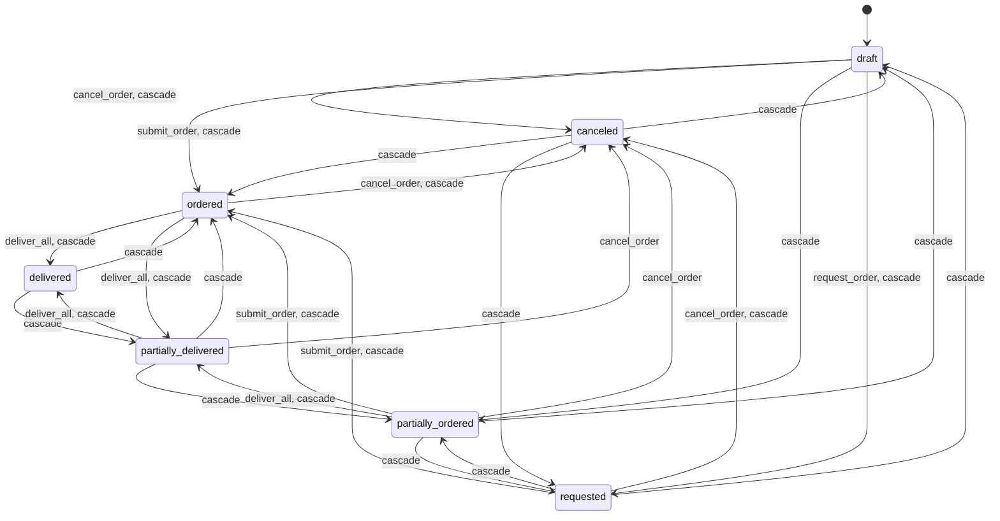

| Action | Starts from | Sets | Condition | Permission |
| ------ | ----------- | ---- | --------- | ---------- |
| `mark_requested` | draft |   |   |   |
| `mark_ordered` | draft, requested, partially_ordered |   |   |   |
| `cancel` | draft, requested, partially_ordered, ordered, partially_delivered |   |   | manage:orders once past REQUESTED |
| `deliver` | partially_ordered, ordered, partially_delivered |   |   |   |
| `edit` | any |   | nobody canceled the order | manage:orders once past REQUESTED |
| `add_item` | any |   | nobody canceled the order | manage:orders once the order or the line is past REQUESTED |

| Row | Condition | Status |
| --- | --------- | ------ |
| 1 | canceled_at set | canceled |
| 2 | no lines | ordered if ordered_date, requested if requested_at, else draft |
| 3 | every line CANCELED | canceled |
| 4 | every live line DELIVERED | delivered |
| 5 | any live line DELIVERED or PARTIALLY_DELIVERED | partially_delivered |
| 6 | ordered_date set, or every live line ORDERED | ordered |
| 7 | any live line ORDERED | partially_ordered |
| 8 | requested_at set, or every live line REQUESTED | requested |
| 9 | otherwise | draft |

## Order item (`order_item_status`)

Status of a single line item within an Order.

Kind: derived. States: `pending`, `requested`, `ordered`, `partially_delivered`, `delivered`, `canceled`.

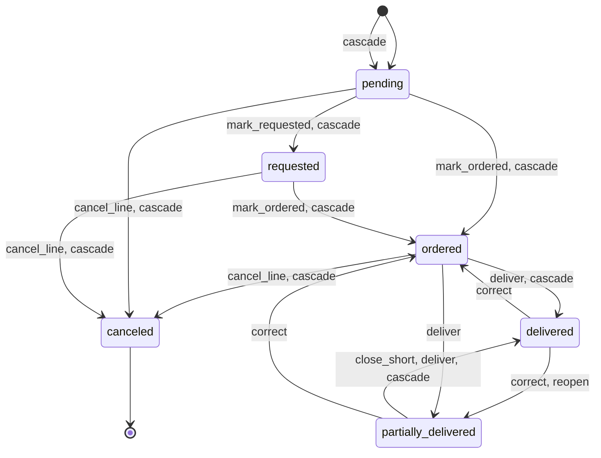

| Action | Starts from | Sets | Condition | Permission |
| ------ | ----------- | ---- | --------- | ---------- |
| `mark_requested` | pending |   |   | manage:orders once the order or the line is past REQUESTED |
| `mark_ordered` | pending, requested |   |   | manage:orders once the order or the line is past REQUESTED |
| `mark_ready_for_pickup` | ordered, partially_delivered |   | order not CANCELED | manage:orders once the order or the line is past REQUESTED |
| `deliver` | ordered, partially_delivered |   | order not CANCELED; lot not canceled for MADE lines |   |
| `correct_delivery` | partially_delivered, delivered |   | not a MADE line; not closed short; order not CANCELED |   |
| `close_short` | ordered, partially_delivered |   | delivered + lost > 0 | manage:orders once the order or the line is past REQUESTED |
| `reopen` | delivered |   | closed short; not a MADE line; order not CANCELED | manage:orders once the order or the line is past REQUESTED |
| `cancel` | pending, requested, ordered |   | no delivery and no lost pieces | manage:orders once the order or the line is past REQUESTED |
| `edit_quantity` | pending, requested, ordered |   |   | manage:orders once the order or the line is past REQUESTED |
| `edit` | pending, requested, ordered, partially_delivered, delivered |   |   | manage:orders once the order or the line is past REQUESTED |
| `move` | pending, requested, ordered |   | no deliveries or rejections; target order without canceled_at | manage:orders once the order or the line is past REQUESTED |
| `remove` | pending, requested |   |   | manage:orders once the order or the line is past REQUESTED |

| Row | Condition | Status |
| --- | --------- | ------ |
| 1 | canceled_at set | canceled |
| 2 | quantity > 0 and delivered + lost >= quantity | delivered |
| 3 | delivered + lost > 0 | partially_delivered |
| 4 | ordered_date set | ordered |
| 5 | requested_at set | requested |
| 6 | otherwise | pending |

## Production order (`production_order_status`)

Status of a ProductionOrder queued on a ProductionMachine.

Kind: derived. States: `queued`, `in_progress`, `paused`, `completed`, `canceled`.

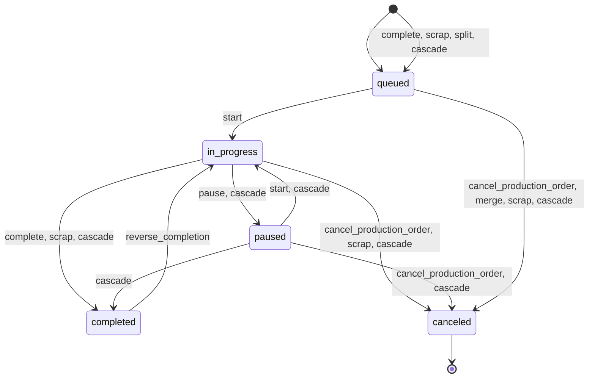

| Action | Starts from | Sets | Condition | Permission |
| ------ | ----------- | ---- | --------- | ---------- |
| `start` | queued |   | lot not held; lot not terminal; machine resolvable; upstream input available |   |
| `resume` | paused |   | an open manual interruption; lot not held; upstream input available |   |
| `pause` | in_progress |   |   |   |
| `cancel` | queued, in_progress, paused |   |   |   |
| `record_completion` | in_progress |   | lot not held |   |
| `reverse_completion` | in_progress, paused, completed |   | lot not held; lot not terminal; the completion rejected nothing, is not reversed yet and the next position has not used its pieces |   |
| `scrap` | in_progress |   | lot not held |   |
| `split` | queued |   |   |   |
| `merge` | queued |   |   |   |

| Row | Condition | Status |
| --- | --------- | ------ |
| 1 | canceled_at set | canceled |
| 2 | quantity > 0 and processed >= quantity | completed |
| 3 | actual_start unset | queued |
| 4 | an interruption with resumed_at unset exists | paused |
| 5 | otherwise | in_progress |

## Lot position kind (`lot_position_kind`)

Who executes a lot position, derived from its live order line and its production orders. UNASSIGNED means nothing is committed: no live line, no live production order and no pieces made in house. EXTERNAL means a live line buys the position from a supplier, INTERNAL that live production orders or pieces already made in house cover it, and MIXED that both do.

Kind: derived. States: `unassigned`, `external`, `internal`, `mixed`.

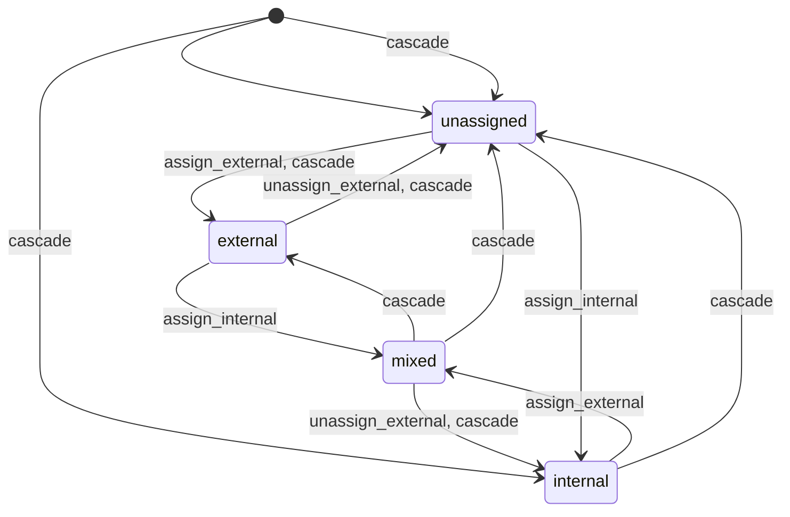

| Action | Starts from | Sets | Condition | Permission |
| ------ | ----------- | ---- | --------- | ---------- |
| `assign_external` | any |   | lot not terminal; no live line, or only lines closed short; kind UNASSIGNED or INTERNAL, or its line closed short; remaining > 0 |   |
| `unassign_external` | any |   | kind EXTERNAL or MIXED; live line PENDING or REQUESTED |   |
| `assign_internal` | any |   | lot not terminal; remaining > 0 |   |
| `record_provision` | any |   | lot not terminal; kind EXTERNAL or MIXED |   |

| Row | Condition | Status |
| --- | --------- | ------ |
| 1 | live line, and (a live order or internal progress > 0) | mixed |
| 2 | live line | external |
| 3 | a live order (not CANCELED) or internal progress > 0 | internal |
| 4 | otherwise | unassigned |

## Lot position (`lot_position_status`)

Status of a lot position. Derived and stored for querying, never set by a user directly. A position whose only side is a supplier line goes from PENDING to ORDERED_OR_QUEUED once the line is ordered, to PARTIALLY_COMPLETED with its first accepted delivery and to COMPLETED when its pieces are in. IN_PROGRESS needs a running production order, since a supplier reports no start.

Kind: derived. States: `pending`, `ordered_or_queued`, `in_progress`, `partially_completed`, `completed`, `canceled`.

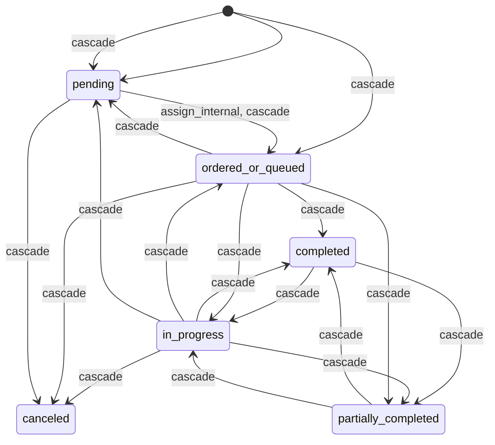

| Row | Condition | Status |
| --- | --------- | ------ |
| 1 | the lot has canceled_at | canceled |
| 2 | quantity > 0 and completed >= quantity | completed |
| 3 | completed > 0 | partially_completed |
| 4 | a live order IN_PROGRESS or PAUSED | in_progress |
| 5 | live line ORDERED or PARTIALLY_DELIVERED, or a live order QUEUED | ordered_or_queued |
| 6 | otherwise | pending |

## Lot (`lot_status`)

Status of a ProductionLot.

Kind: derived. States: `draft`, `partially_planned`, `planned`, `in_progress`, `on_hold`, `completed`, `canceled`, `scrapped`.

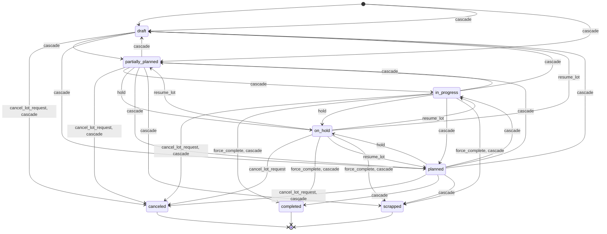

| Action | Starts from | Sets | Condition | Permission |
| ------ | ----------- | ---- | --------- | ---------- |
| `hold` | partially_planned, planned, in_progress |   |   |   |
| `resume` | on_hold |   |   |   |
| `cancel` | draft, partially_planned, planned, in_progress, on_hold |   | no position completed a good piece | manage:lots |
| `force_complete` | draft, partially_planned, planned, in_progress, on_hold |   | a position completed a good piece | manage:lots |
| `scrap` | draft, partially_planned, planned, in_progress |   |   |   |
| `edit_structure` | draft, partially_planned, planned, in_progress, on_hold |   |   |   |
| `reorder_positions` | draft, partially_planned, planned, in_progress, on_hold |   |   |   |
| `edit_quantity` | draft |   |   |   |
| `approve_source` | draft, partially_planned, planned, in_progress, on_hold |   | material source pending or rejected; the project is active and the source item demandable |   |
| `reject_source` | draft, partially_planned, planned, in_progress, on_hold |   | material source pending |   |
| `switch_source` | draft, partially_planned, planned, in_progress, on_hold |   | the raw material demand, if any, is not fulfilled |   |

| Row | Condition | Status |
| --- | --------- | ------ |
| 1 | canceled_at set | canceled |
| 2 | quantity is zero | scrapped |
| 3 | force_completed_at set, or positions non-empty and every position COMPLETED | completed |
| 4 | held_at set | on_hold |
| 5 | any position IN_PROGRESS, PARTIALLY_COMPLETED or COMPLETED | in_progress |
| 6 | positions non-empty and none PENDING | planned |
| 7 | any position not PENDING | partially_planned |
| 8 | otherwise | draft |

## Bought item demand (`bought_item_demand_status`)

Status of a BoughtItemDemandItem (project need).

Kind: derived. States: `open`, `allocated`, `ordered`, `fulfilled`, `canceled`.

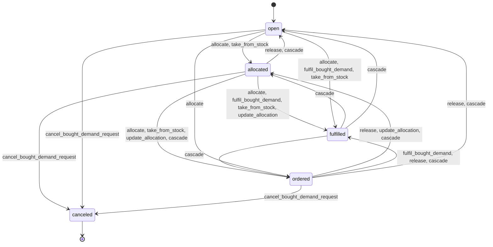

| Action | Starts from | Sets | Condition | Permission |
| ------ | ----------- | ---- | --------- | ---------- |
| `cancel` | open, allocated, ordered |   | lot not started |   |
| `fulfil` | open, allocated, ordered |   |   |   |
| `allocate` | open, allocated, ordered |   |   |   |
| `edit_quantity` | open, allocated, ordered |   |   |   |
| `remove` | any |   | no allocations |   |

| Row | Condition | Status |
| --- | --------- | ------ |
| 1 | canceled_at set | canceled |
| 2 | fulfilled_manually_at set | fulfilled |
| 3 | delivered + stock >= quantity | fulfilled |
| 4 | allocated + stock >= quantity and every order- or lot-sourced allocation above zero is placed | ordered |
| 5 | allocated + stock > 0 | allocated |
| 6 | otherwise | open |

## Made item demand (`made_item_demand_status`)

Status of a MadeItemDemandItem (project need).

Kind: derived. States: `open`, `allocated`, `ordered`, `fulfilled`, `canceled`.

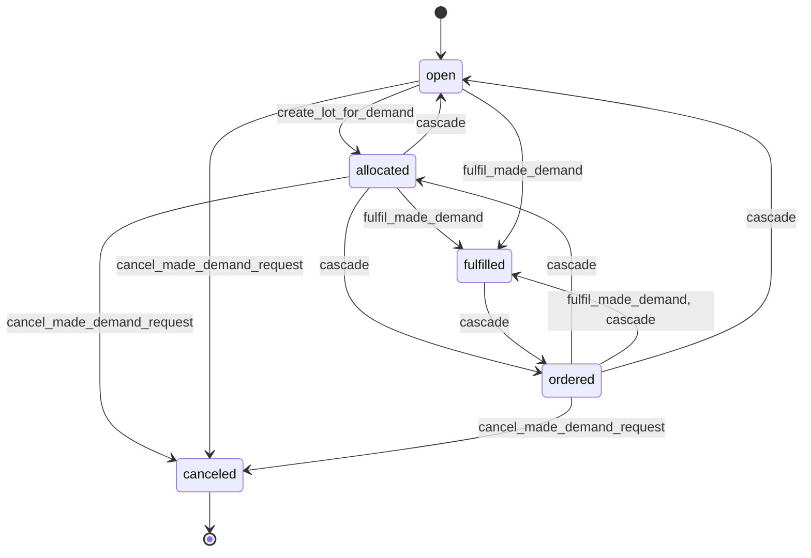

| Action | Starts from | Sets | Condition | Permission |
| ------ | ----------- | ---- | --------- | ---------- |
| `cancel` | open, allocated, ordered |   | lot not started |   |
| `fulfil` | open, allocated, ordered |   |   |   |
| `allocate` | open, allocated, ordered |   |   |   |
| `edit_quantity` | open, allocated, ordered |   |   |   |
| `remove` | any |   | no allocations |   |

| Row | Condition | Status |
| --- | --------- | ------ |
| 1 | canceled_at set | canceled |
| 2 | fulfilled_manually_at set | fulfilled |
| 3 | delivered + stock >= quantity | fulfilled |
| 4 | allocated + stock >= quantity and every order- or lot-sourced allocation above zero is placed | ordered |
| 5 | allocated + stock > 0 | allocated |
| 6 | otherwise | open |

## Source item demand (`source_item_demand_status`)

Kind: derived. States: `open`, `allocated`, `ordered`, `fulfilled`, `canceled`.

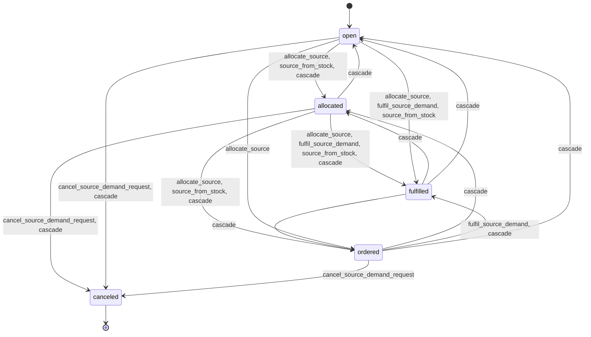

| Action | Starts from | Sets | Condition | Permission |
| ------ | ----------- | ---- | --------- | ---------- |
| `cancel` | open, allocated, ordered |   | lot not started |   |
| `fulfil` | open, allocated, ordered |   |   |   |
| `allocate` | open, allocated, ordered |   |   |   |
| `edit_quantity` | open, allocated, ordered |   |   |   |
| `remove` | any |   | no allocations |   |

| Row | Condition | Status |
| --- | --------- | ------ |
| 1 | canceled_at set | canceled |
| 2 | fulfilled_manually_at set | fulfilled |
| 3 | delivered + stock >= quantity | fulfilled |
| 4 | allocated + stock >= quantity and every order- or lot-sourced allocation above zero is placed | ordered |
| 5 | allocated + stock > 0 | allocated |
| 6 | otherwise | open |

## Catalogue item (`catalogue_item_status`)

Status of a BoughtItem catalogue entry.

Kind: intent. States: `active`, `inactive`, `replaced`.

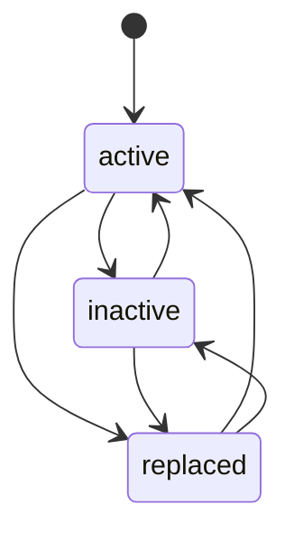

| Action | Starts from | Sets | Condition | Permission |
| ------ | ----------- | ---- | --------- | ---------- |
| `set_status` | active, replaced | inactive |   |   |
| `set_status` | active, inactive | replaced |   |   |
| `set_status` | inactive, replaced | active |   |   |

## Project (`project_status`)

Status of a Project, which a user moves through the intents of PROJECT_INTENTS (domain/services/lifecycle/project.py): an active project goes on hold and is resumed, is completed or archived once no work on it is live, and is reopened after being completed or archived. Every other move is refused.

Kind: intent. States: `active`, `on_hold`, `completed`, `archived`.

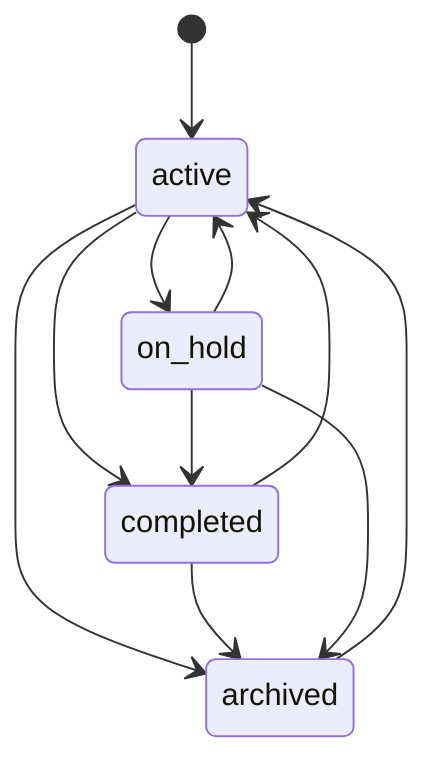

| Action | Starts from | Sets | Condition | Permission |
| ------ | ----------- | ---- | --------- | ---------- |
| `hold` | active |   |   |   |
| `resume` | on_hold |   |   |   |
| `complete` | active, on_hold |   | no live lots, production orders, order lines, demands or open quote requests |   |
| `archive` | active, on_hold, completed |   | no live lots, production orders, order lines, demands or open quote requests |   |
| `reopen` | completed, archived |   |   |   |
| `remove` | any |   | no live lots, production orders, order lines, demands or open quote requests |   |

## Quote request (`quote_request_status`)

DRAFT until a supplier was sent the request, SENT while lines wait for an award, AWARDED once every line is awarded or dropped and one was awarded, CLOSED once someone closed it or dropped every line, CANCELED once someone canceled it.

Kind: derived. States: `draft`, `sent`, `awarded`, `closed`, `canceled`.

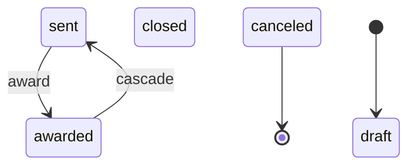

| Action | Starts from | Sets | Condition | Permission |
| ------ | ----------- | ---- | --------- | ---------- |
| `send` | draft, sent |   | a line; a supplier |   |
| `award` | draft, sent |   | an open line |   |
| `close` | draft, sent |   | an awarded line |   |
| `cancel` | draft, sent |   | no awarded line |   |
| `reopen` | closed |   | a recorded close; a line whose award was voided |   |

| Row | Condition | Status |
| --- | --------- | ------ |
| 1 | canceled_at set | canceled |
| 2 | closed_at set | closed |
| 3 | every line awarded or dropped, at least one awarded | awarded |
| 4 | every line dropped | closed |
| 5 | sent to a supplier | sent |
| 6 | otherwise | draft |
