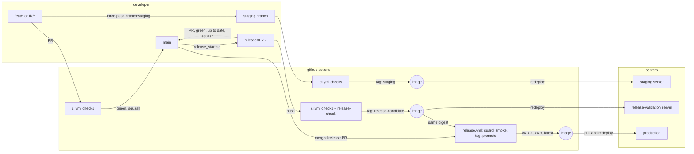

# releasing

- [releasing](#releasing)
  - [1 versioning policy](#1-versioning-policy)
    - [1.1 how a client checks the backend it talks to](#11-how-a-client-checks-the-backend-it-talks-to)
  - [2 branches and release flow](#2-branches-and-release-flow)
    - [2.1 day-to-day work](#21-day-to-day-work)
    - [2.2 cutting a release](#22-cutting-a-release)
    - [2.3 what ci does at each step](#23-what-ci-does-at-each-step)
    - [2.4 when the release run fails](#24-when-the-release-run-fails)
  - [3 minor releases](#3-minor-releases)
  - [4 test servers: staging and release-candidate](#4-test-servers-staging-and-release-candidate)
    - [4.1 the two channels](#41-the-two-channels)
    - [4.2 deploying to staging](#42-deploying-to-staging)
    - [4.3 pointing a server at a channel](#43-pointing-a-server-at-a-channel)
    - [4.4 caveats](#44-caveats)
    - [4.5 which commit is running](#45-which-commit-is-running)
  - [5 the pat snapshot check](#5-the-pat-snapshot-check)
  - [6 github setup](#6-github-setup)
  - [7 what operators see](#7-what-operators-see)

This document covers how GLADOS versions and releases are cut. The backend (`backend/`) and frontend (`frontend/`) live in one repository and release together: one version, one tag, one build.

Development is trunk-based: `main` is the only long-lived branch, every change reaches it as a squash-merged pull request, and `main` is always releasable. A release is a pull request from `release/X.Y.Z` that only bumps the version and the CHANGELOG. Merging it is the release: a workflow tags the merge commit and publishes the images, nobody pushes a tag by hand. See [section 2](#2-branches-and-release-flow), and [ADR 0004](adr/0004-trunk-based-release-flow.md) for why the flow is shaped this way.

## 1 versioning policy

The repository has exactly one source of truth for its version: `[project].version` in `backend/pyproject.toml`. `src/modules/platform/const.py` reads it at import time, so the whole running app, including `GET /health` ([section 7](#7-what-operators-see)), agrees with the committed file. `frontend/package.json`'s `version` mirrors the same value, and CI's `version-parity` job fails the build if the two files disagree. Set both at once with:

```bash
scripts/bump_version.sh X.Y.Z
```

The bump script accepts any major; only the release scripts insist on `0.Y.Z` ([reference/releasing-ci.md section 4](reference/releasing-ci.md#4-release-scripts)).

The first release is `v0.1.0`. From its tag on, `backend/openapi/pat-v0.1.json` is frozen ([section 5](#5-the-pat-snapshot-check)), and Glados runs against production databases: released migrations are immutable and every later migration carries the production data forward ([DEVELOPMENT.md section 6](DEVELOPMENT.md#6-database-migrations)).

Released versions follow `0.Y.Z`, with a meaning specific to this project:

| Level | Meaning |
| --- | --- |
| **major** | `0` until a deliberate `1.0`. Release branches and the release workflow reject any other major until then. |
| **minor** | The `pat` surface's contract changed in any way, additions, changes and removals alike, see [section 5](#5-the-pat-snapshot-check). |
| **patch** | No change to the `pat` surface. Bugfixes and everything else, including any change to the `web` surface. |

A patch release never changes the frozen `pat` contract, which CI enforces ([section 5](#5-the-pat-snapshot-check)); the `web` surface, the one `frontend/` talks to, may change on any commit. Because a minor may remove `pat` endpoints or fields, external clients such as the SolidWorks add-in state the backend minors they support, not only a minimum.

### 1.1 how a client checks the backend it talks to

`GET /api/v1/pat/version` answers any valid personal access token, without a permission, with the backend version and the `pat` contract it serves, the version's `major.minor`:

```json
{"version": "0.2.3", "pat_contract": "0.2"}
```

Every response under `/api/v1/pat`, `/api/v1/key` and `/api/v1/public`, the surfaces the `pat` snapshot bundles, errors included, also carries the header `X-Glados-Version: 0.2.3`, so a client learns the version from whichever call it makes, even a 401 or the 404 of a route an older backend does not have. Those surfaces declare their error responses in the snapshot as `ErrorResponse` (`detail`, and the refusing error's class name as `code`).

A client calls the route once when it connects and compares `pat_contract` with the list of minors it was built and tested against. On a match it carries on. On a minor it does not list, newer or older, it shows a warning that names the backend version it found and the contract minors it supports, and then keeps working. A different minor may have changed or removed a route the client uses, so such a call can fail, and the warning tells the user why. A client never compares the patch number, since a patch never changes the contract. The SolidWorks add-in and the PDM vault add-in both follow this rule.

## 2 branches and release flow

The full picture, release flow and test-server channels together (the channels are covered in [section 4](#4-test-servers-staging-and-release-candidate)):



### 2.1 day-to-day work

1. Branch from an up-to-date `main`: `git checkout main && git pull && git checkout -b feat/lot-priority`.
2. Commit as often as you like and push. Optionally deploy the branch to the staging server ([section 4.2](#42-deploying-to-staging)).
3. Open a pull request into `main`. CI runs on it; fix and push until it is green.
4. Squash-merge it. The pull request title becomes the single commit on `main`, and the branch is deleted. Nothing is released yet.

Unfinished work does not go to `main`, since everything on `main` ships with the next release: keep it on its branch (rebase it onto `main` now and then), or merge it behind a host capability flag. A branch that lives through a release must be rebased onto `main` before its pull request, because the release squash replaced the commits it shares with `main`.

### 2.2 cutting a release

1. Run `scripts/release_start.sh X.Y.Z`. It refuses a dirty tree or an existing branch or tag, branches `release/X.Y.Z` from an up-to-date `main`, bumps both version files, re-exports the OpenAPI snapshots, regenerates the frontend's API types, turns the `[Unreleased]` section of `CHANGELOG.md` into `[X.Y.Z] - YYYY-MM-DD`, commits `release: X.Y.Z` and pushes the branch.
2. The push runs CI including `release-check`, and once green publishes the `release-candidate` image for the release-validation server ([section 4](#4-test-servers-staging-and-release-candidate)). Polish the CHANGELOG section and add small release fixes on the branch as needed; every push rebuilds the candidate.
3. Open a pull request into `main`. If `main` moved in the meantime, use "Update branch" on the pull request, which rebuilds and revalidates the candidate. The `main` ruleset refuses the merge until the branch is up to date, so the tagged commit is exactly what the candidate ran.
4. Squash-merge it. `release.yml` starts the release candidate's images once on an empty database, tags the merge commit `vX.Y.Z`, publishes those same images under the release tags and creates the GitHub Release with the CHANGELOG section as its notes ([section 2.3](#23-what-ci-does-at-each-step)).

The same sequence covers hotfixes: a `fix/*` pull request into `main`, followed directly by `scripts/release_start.sh` for the next patch.

### 2.3 what ci does at each step

Every pull request and every push to `staging` or `release/**` runs the `ci.yml` checks; a pull request that touches only docs skips the code jobs. Merging does not rerun them on `main`, because the `main` ruleset only merges a pull request whose checks passed against the current `main`. A release branch also runs `release-check` and the Postgres race tests of `tests/pg`, which take over 20 minutes, so a change that touches locking runs them locally first ([DEVELOPMENT.md section 9](DEVELOPMENT.md#9-test-conventions)); `nightly.yml` runs all of `tests/pg` on `main` every night as well. Once green, a push to `staging` or `release/**` publishes its channel image ([section 4](#4-test-servers-staging-and-release-candidate)), and a release branch's images are also tagged with their commit; `ghcr-retention.yml` deletes all but the newest 30 of those images once a week, never one a release promoted. Merging a release pull request runs `release.yml`, which checks the merge, finds the release candidate's images by the release branch's head commit, starts them on an empty database, tags the merge commit `vX.Y.Z`, gives those same images the tags `vX.Y.Z`, `vX.Y` and `latest` without rebuilding them, and creates the GitHub Release. A tag pushed by hand publishes nothing.

Full rules: [reference/releasing-ci.md](reference/releasing-ci.md).

### 2.4 when the release run fails

If `guard`, `resolve` or `smoke` failed, nothing was tagged or published, but `main` now carries the new version. Check what went wrong in the run log:

- `resolve` waits up to 50 minutes for the release branch's own CI run to publish the candidate. When that run failed or was cancelled, re-run it from its run page, then re-run the release run's failed jobs.
- A failed `smoke` means the candidate does not start on an empty database. Fix `main` through normal pull requests and cut the next patch; the version on `main` is never tagged.
- When `main`'s head is still the merge of the release pull request and the cause is fixed elsewhere, start *Actions → Release → Run workflow* on `main` with the version as input. It finds that pull request's candidate and runs the same checks, smoke test and promotion. Once anything else has been merged to `main`, no tested candidate matches it, so cut the next patch instead.

If `tag` succeeded and a later job failed, re-run the failed jobs from the run page; the tag stays where it is.

## 3 minor releases

A minor bump means the `pat` surface's contract changed (see [section 5](#5-the-pat-snapshot-check)); a version whose only API changes are to the `web` surface, or that changes no surface at all, stays a patch.

Once a minor has been released, the pull request that changes the `pat` surface fails CI's snapshot check until it bumps the minor itself:

```bash
scripts/bump_version.sh 0.3.0
(cd backend && poetry run python scripts/export_openapi.py)
```

Releasing then works exactly like [section 2.2](#22-cutting-a-release); `scripts/release_start.sh 0.3.0` notices that `main` already carries `0.3.0` and only adds the CHANGELOG section.

## 4 test servers: staging and release-candidate

Two test servers each track a mutable **channel** tag instead of a version: a **staging server** for work in progress from any branch, and a **release-validation server** for a release branch under review before it is tagged and merged. Neither channel is a release, and a red CI run publishes nothing, so the server keeps running whatever it had before.

### 4.1 the two channels

| Push to | Tag | Server | Purpose |
| --- | --- | --- | --- |
| branch `staging` | `staging` | staging server | test whatever branch is currently force-pushed to `staging` |
| any `release/**` branch | `release-candidate` | release-validation server | validate a release branch before it's tagged and merged |

A push to either branch runs every check job, and the image is published only once they pass ([reference/releasing-ci.md section 1.3](reference/releasing-ci.md#13-channel-images)).

### 4.2 deploying to staging

`staging` is a single branch and a **deploy pointer**, not a line of history: force-push whatever you want the staging server to run onto it (refspec `<local>:<remote>`; no local `staging` branch needed):

```bash
git push --force origin release/0.2.0:staging     # a release candidate
git push --force origin feat/xyz:staging          # or anything else
```

`scripts/deploy_staging.sh` (also the VS Code task *deploy: staging*) does the same for whatever is checked out, `git push --force origin HEAD:staging`.

- Never merge *from* `staging`; its history is whatever was pushed last and means nothing.
- Only maintainers can create, update or delete the branch, through its ruleset ([section 6](#6-github-setup)), and force-pushes stay allowed for them.
- Deleting it with `git push origin :staging` is harmless. The server keeps running its last pulled image and the GHCR `staging` tag is untouched, so nothing is cleaned up. Push again to recreate it.

`release/**` branches need no deploy step: `release-candidate` publishes automatically as part of the normal release flow.

### 4.3 pointing a server at a channel

Point each test server at its channel with `GLADOS_VERSION`, set once and never edited again:

```bash
# staging server .env; the release-validation server sets
# GLADOS_VERSION=release-candidate instead
GLADOS_VERSION=staging
```

Nothing in the stack updates itself, so pull and redeploy after each push to the channel, or in Portainer **Update the stack** with **Re-pull image and redeploy** ticked:

```bash
docker compose pull
docker compose up -d
```

If only one image needs to run something under test, `BACKEND_VERSION` and `FRONTEND_VERSION` override `GLADOS_VERSION` per image (see [INSTALLATION.md, section 5](INSTALLATION.md#5-configuration)), for example to keep one side on a real release line while testing the other:

```bash
# .env: backend on the staging channel, frontend on its last release
GLADOS_VERSION=v0.2
BACKEND_VERSION=staging
```

Production instead pins a real minor line, for example `GLADOS_VERSION=v0.1`.

### 4.4 caveats

> [!WARNING]
> `BACKEND_VERSION` and `FRONTEND_VERSION` pull independently: whatever
> combination ends up running must be the *exact same version*, or the
> version-mismatch banner ([section 7](#7-what-operators-see)) appears. It
> compares the full `X.Y.Z`, not just `major.minor`.

> [!WARNING]
> Migrations are forward-only. Each test server follows **one line of work
> at a time**: pushing branch A (with migration `0042`) and then branch B
> (which does not contain `0042`) leaves that server's database ahead of the
> code, and the backend refuses to start. When switching to an unrelated
> branch, restore that server's database from a backup first or reset it
> (`docker compose down -v` on that host, destroys all its data).

### 4.5 which commit is running

Every image, channel and release alike, carries OCI labels, and `org.opencontainers.image.revision` is the commit SHA it was built from. A release image is the release candidate itself, so its revision is the release branch's last commit rather than the squash commit the tag points at; the release workflow checks that both hold the same tree:

```bash
docker inspect --format '{{ index .Config.Labels "org.opencontainers.image.revision" }}' glados-backend-1
```

In Portainer, the same label is under Containers → `glados-backend-1` → *Labels*. The GHCR package page shows the same labels per image version.

## 5 the pat snapshot check

`backend/scripts/check_openapi.py` keeps a patch release from changing the `pat` contract, using the snapshots in `backend/openapi/`: `pat-vX.Y.json` for the frozen external contract (`pat`, `key` and `public`) and `web-vX.Y.json` for the `web` surface. It fails when a snapshot differs from the live schema, which `poetry run python scripts/export_openapi.py` fixes, and when the `pat` snapshot changed after a `vX.Y.*` tag was released, which only a minor bump in the same pull request fixes ([section 3](#3-minor-releases)). In CI it also fails when it cannot fetch the tags or cannot read the snapshot at the released tag, so the freeze is never skipped unseen; run locally, both only warn. The `web` snapshot may change on any commit, and the frontend checks its half with `npm run check:api-types`.

Full rules: [reference/releasing-ci.md section 2](reference/releasing-ci.md#2-the-pat-snapshot-check).

## 6 github setup

The repository settings, rulesets and package visibility are configured by hand in GitHub; no workflow changes them. In short, squash is the only merge method, the `main` ruleset requires the CI checks on a branch that is up to date with `main`, `v*` tags are immutable, only maintainers can push to `staging` (force pushes included), and both GHCR packages are public. Dependabot only raises alerts, so dependencies are updated by hand, and the `xlsx` package needs a manual advisory check because it comes from the SheetJS CDN.

Full settings: [reference/releasing-github-setup.md](reference/releasing-github-setup.md).

## 7 what operators see

None of this is visible to an operator running the stack directly, it all happens upstream in GitHub Actions. What they do see:

- `GET /health` (unauthenticated) returns `{"status":"ok","version":"0.1.0"}`, reflecting whichever image tag is actually running.
- The frontend compares its own build version against the backend's `/health` response on boot (the full `X.Y.Z`, not just `major.minor`) and shows a persistent "server/app version mismatch" banner if they disagree (the dev placeholder version `0.0.0` is excluded from the check). In practice this means either a stale cached frontend bundle, or `BACKEND_VERSION` / `FRONTEND_VERSION` image overrides in the deployment that no longer agree.

For how an operator picks a version to pull and upgrades to it, see [INSTALLATION.md, section 8](INSTALLATION.md#8-upgrade).
