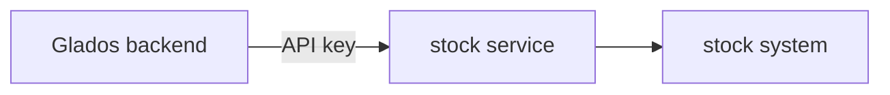

# stock service

- [stock service](#stock-service)
  - [1 purpose and scope](#1-purpose-and-scope)
  - [2 components](#2-components)
  - [3 configuration](#3-configuration)
  - [4 security](#4-security)
  - [5 what comes next](#5-what-comes-next)

## 1 purpose and scope

A stock system knows what is on hand in the warehouse. Glados will read from it through a stock service, a separate container in the same stack, over a provider-neutral HTTP contract that Glados defines ([reference/stock-service.md](reference/stock-service.md)). Glados contains nothing specific to any stock system, so another one plugs in by running another service that implements the contract.

So far only the connection exists: the admin settings, a connection test and the card on the Host tab's service panel. No feature reads stock data yet, and the contract will grow with the first one.

## 2 components

The port is `IStockService` (`external_data/ports/outbound/stock_service_port.py`), implemented by the HTTP client in `backend/src/modules/external_data/adapters/outbound/external/stock_service/`. The settings belong to CAD and external data, next to the other outside data sources. The service runs in the same Docker stack, publishes no port, and ships its own compose entry; Glados' compose files do not name it.

## 3 configuration

The Stock Service tab in the admin settings edits the settings row.

| Setting | Meaning |
| ------- | ------- |
| Enabled | Switches the stock service on. Requires the service URL and the API key. |
| Service URL | The stock service in the stack, for example `http://stock-service:3200`. Plain http is fine there, since the service publishes no port. |
| API key | The key the service accepts. Write-only and encrypted at rest. |

The connection test shows the service's version, the contract version it speaks (with a warning when Glados does not support it) and the label and version of the stock system behind it. It works with unsaved values and stores nothing. Every change is audited.

What is specific to the stock system, its address, credentials and certificates, is configured on the service, not in Glados.

Full rules: [reference/stock-service.md sections 1 and 2](reference/stock-service.md#1-settings).

## 4 security

- The API key is encrypted at rest with the instance key, never returned by any route and never written to a log or an error.
- The client never follows a redirect, so the API key cannot travel to a redirect target.
- The service publishes no port, so only containers on the stack's network reach it, and only with the API key.

## 5 what comes next

A feature that reads stock data adds its routes to the contract, bumps the contract minor in Glados and in the service together ([reference/stock-service.md section 5](reference/stock-service.md#5-versions)), and documents its rules here and in the reference.
