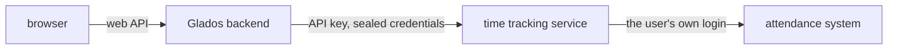

# time tracking

- [time tracking](#time-tracking)
  - [1 purpose and scope](#1-purpose-and-scope)
  - [2 components and data flow](#2-components-and-data-flow)
  - [3 configuration](#3-configuration)
  - [4 per-user credentials](#4-per-user-credentials)
  - [5 the time tracking view](#5-the-time-tracking-view)
  - [6 security](#6-security)
    - [6.1 assets](#61-assets)
    - [6.2 trust boundaries](#62-trust-boundaries)
    - [6.3 main mitigations and risks](#63-main-mitigations-and-risks)
    - [6.4 operator duties](#64-operator-duties)
  - [7 limits](#7-limits)

## 1 purpose and scope

An attendance system computes worked time, target time, balances and accounts from the stamps employees make at its terminals. Glados shows a signed-in user their own attendance data from it (today, the current month, balances, accounts, a year overview) on the Time Tracking page of their account. Nothing else.

Glados never talks to the attendance system itself. A time tracking service, a separate container in the same stack, does; Glados calls it over a provider-neutral HTTP contract that Glados defines ([reference/time-tracking-provider.md](reference/time-tracking-provider.md)). Glados contains nothing specific to any attendance system, so another one plugs in by running another service that implements the contract.

The integration is deliberately narrow:

- **Nothing read is stored.** No journal, booking, account, balance, employee id, employee name or right is written to the database, Redis, a file or a cache, neither in Glados nor in the service. The only time tracking rows are the admin settings and each user's sealed credentials with the Glados state that guards them.
- **Data is fetched only on demand.** Opening the Time Tracking page, switching the month there, opening its year section or pressing its reload button calls the service. No other page, no dashboard widget, no login hook and no background job does. Three explicit actions verify a login without loading data: the admin connection test, and a user's own Save and Check access in My Account.
- **Each user signs in as themselves.** There is no service account. Every read signs in with the requesting user's own credentials, so a user can only ever read what their own account on the attendance system may read.
- **Read-only.** Nothing is ever written to the attendance system.

## 2 components and data flow

When the user opens the page, the backend sends the user's sealed credentials and their binding to the service. The service opens them with its private key, signs in to the attendance system as that user, reads, signs out and answers neutral values (durations in seconds, times in UTC). Glados computes today's live figures, the month totals and the year lines from them, shows the page and keeps nothing.

The port is `ITimeTrackingProvider` (`time_tracking_provider_port.py`), implemented by the HTTP client in `backend/src/modules/operations/adapters/outbound/external/time_tracking_service/`. The service runs in the same Docker stack, publishes no port, and ships its own compose entry; Glados' compose files do not name it.

## 3 configuration

The Time Tracking tab in the admin settings edits the settings row.

| Setting | Meaning |
| ------- | ------- |
| Enabled | Switches time tracking on. Requires the service URL and the API key. |
| Service URL | The time tracking service in the stack, for example `http://time-tracking:3100`. Plain http is fine there, since passwords travel sealed and the service publishes no port. |
| API key | The key the service accepts. Write-only and encrypted at rest. |
| Credential key | The public key users' credentials are sealed for. A connection test shows the key the service serves, and the admin confirms it once. Users can use time tracking only once a key is confirmed. |
| Privacy policy URL | Linked from the users' consent dialog, so company-specific wording stays outside Glados. |

The connection test shows the service's version, the contract version it speaks (with a warning when Glados does not support it), the version and default project of the attendance system behind it, and its credential key. The tab lists every user with stored credentials and whether those can be used, and a button deletes all of them. Every change is audited.

What is specific to the attendance system, its URL, certificates, default project and time zone, is configured on the service, not in Glados.

Full rules: [reference/time-tracking-credentials.md sections 1 and 2](reference/time-tracking-credentials.md#1-settings).

## 4 per-user credentials

A user enters their time tracking user name and password in My Account. Glados seals both for the service's confirmed credential key right away, so the password is never stored in a form Glados can read, and has the service verify them with a live login. The sealed value is stored only after that login succeeded, time tracking is available, the account is a personal one, the user confirmed the current consent text, and no other Glados user holds the same user name.

Stored credentials are used only while Glados itself can tell they are still good: the user name decrypts, they were sealed for the confirmed key, the service has not reported a changed server or key since, the attendance system has not rejected them since, and the consent is current. Otherwise nothing is sent and the user is asked to enter the password again.

Users can remove their credentials at any time, deactivating a user deletes them, and disabling time tracking keeps them for a later re-enable.

Full rules: [reference/time-tracking-credentials.md](reference/time-tracking-credentials.md).

## 5 the time tracking view

The Time Tracking page reads the signed-in user's month and, when the year section is opened, the months of the year so far. Both need only a sign-in, refuse future periods and are never cached. Closed days show the attendance system's own figures; today is computed live from its stamps, so worked time, the running balance and "target reached at" move while the user is clocked in. Accounts are generic, so Glados renders whatever accounts the service returns by their format. Fetches are spaced per user.

Full rules: [reference/time-tracking-provider.md section 6](reference/time-tracking-provider.md#6-the-time-tracking-view).

## 6 security

### 6.1 assets

- Each user's personal password for the attendance system, which often unlocks more than attendance data there.
- Each user's attendance data while it passes through.
- The API key Glados calls the service with.

### 6.2 trust boundaries

- **Browser to Glados.** HTTPS with the Glados session. The password crosses it only when the user saves it.
- **Glados to the service.** The stack's internal network. It carries the API key and sealed credentials, which only the service can open.
- **The service to the attendance system.** Configured and secured on the service; the password travels there as the attendance system requires.
- **Glados and its database.** The database holds the sealed credentials and the encrypted API key and user names; the host holds the encryption key, the service holds the key that opens the sealed credentials.

### 6.3 main mitigations and risks

Glados cannot read a stored password: reading one needs both a sealed value from the Glados database and the service's private key. Credentials are bound to the server and key they were verified for, failed checks lock out after a few attempts, stored credentials stop after the first rejection, and no secret reaches a log, an error or a redirect target. Users confirm a consent dialog before anything is stored. What remains is that someone controlling both the Glados database and the service can open every sealed password, and that the attendance system's own interface may change under the service.

Full mitigation list and residual risks: [reference/time-tracking-security.md](reference/time-tracking-security.md).

### 6.4 operator duties

- Run the service only on the stack's internal network and keep its port unpublished.
- Keep the service's private key out of Glados' database backups; whoever holds both can read every stored password.
- Back up `SECURITY__ENCRYPTION_KEY` whenever the database is backed up, but keep that copy separate from the dumps. It encrypts the API key and the stored user names.
- Systems that process employee data can be subject to co-determination by the works council and to data protection review. The consent dialog informs users and records a voluntary opt-in, but does not replace either. Clarify both before rollout. This is not legal advice.
- Use "Delete All Stored Credentials" for incidents and when switching time tracking off for good.

## 7 limits

- Time tracking depends on the service and on the attendance system behind it; if either is down, the page shows an error.
- Replacing the service's credential key, or pointing Glados at another service, makes every stored credential unusable until its user enters the password again, because Glados cannot re-seal a password it cannot read.
